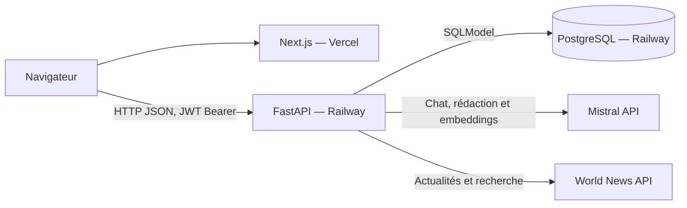
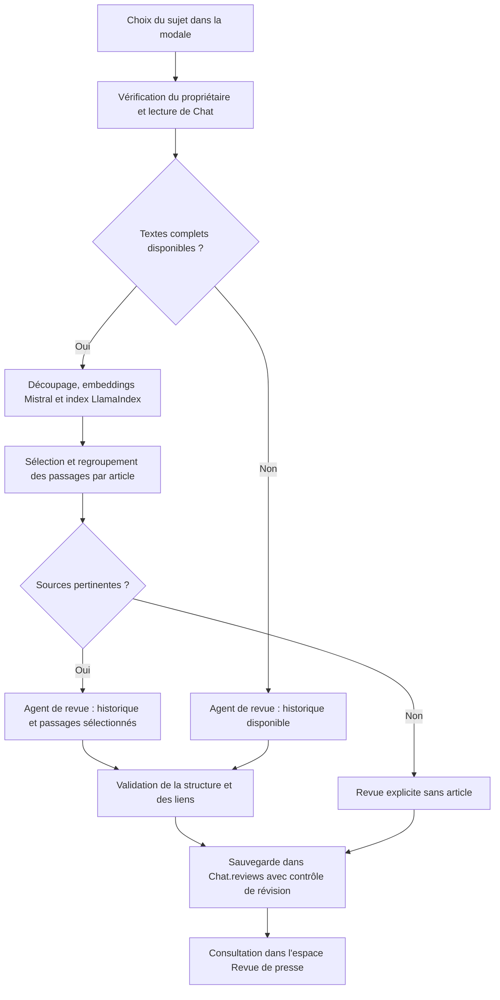

# Architecture et choix techniques

## Organisation générale

NewsFoundry est un monorepo : Next.js et FastAPI sont versionnés dans le même dépôt, avec des dépendances et des déploiements propres à chaque dossier. Une fonctionnalité frontend/backend peut ainsi évoluer dans un même commit et être vérifiée par une CI commune.

Le navigateur charge l'interface Next.js puis appelle directement l'API FastAPI. PostgreSQL conserve les utilisateurs, les discussions, les articles et les revues. Le backend contacte Mistral et World News API ; leurs clés restent dans ses variables d'environnement.



En local, le frontend écoute sur `3000`, le backend sur `8000` et PostgreSQL est exposé par Docker sur `5434`. Le backend utilise `PORT` sur Railway. `CORS_ORIGINS` autorise les origines du frontend à appeler l'API depuis le navigateur.

## Structure du dépôt

```text
NewsFoundry/
├── README.md                         # Point d'entrée et commandes principales
├── frontend/
│   ├── package.json                  # Dépendances et scripts npm
│   ├── package-lock.json             # Versions JavaScript verrouillées
│   ├── .env.example                  # Exemple de configuration publique
│   └── src/
│       ├── app/
│       │   ├── layout.jsx            # Mise en page, polices et métadonnées
│       │   ├── page.jsx              # Session et espace connecté
│       │   └── connexion/page.jsx    # Formulaire de connexion
│       ├── components/
│       │   ├── ChatWorkspace.jsx     # Navigation et échanges dans le chat
│       │   ├── MessageBubble.jsx     # Messages et Markdown
│       │   ├── ReviewDialog.jsx      # Sujet et état de génération
│       │   ├── PressReviews.jsx      # Consultation, sources et copie
│       │   └── *.module.css          # Styles propres aux composants
│       └── lib/
│           ├── auth.js               # Appels HTTP, JWT et session
│           └── chats.js              # Appels des discussions et revues
├── backend/
│   ├── pyproject.toml                # Dépendances et configuration pytest
│   ├── uv.lock                       # Versions Python verrouillées
│   ├── Dockerfile                    # Image du backend pour Railway
│   ├── .env.example                  # Exemple de configuration privée
│   ├── src/
│   │   ├── main.py                   # Application, CORS et erreurs communes
│   │   ├── auth.py                   # Connexion et contrôle des JWT
│   │   ├── database.py               # Sessions SQL et initialisation
│   │   ├── models.py                 # Modèles User et Chat
│   │   ├── migrations.py             # Ajout des champs JSON aux anciennes bases
│   │   ├── chats.py                  # Routes et sauvegarde des échanges
│   │   ├── chat_agent.py             # Agent conversationnel et outil search_news
│   │   ├── news.py                   # World News API et collecte des textes
│   │   ├── reviews.py                # Génération et consultation des revues
│   │   ├── review_agent.py           # Rédacteur, sortie structurée et sources
│   │   ├── embeddings.py             # Adaptateur Mistral pour LlamaIndex
│   │   └── rag.py                    # Index temporaire et passages pertinents
│   └── tests/                        # Tests pytest, fixtures et modèles simulés
├── docs/                             # Guides fonctionnels et techniques
└── .github/workflows/ci.yml           # Vérifications automatiques
```

## Choix techniques et raisons

| Choix | Raison |
| --- | --- |
| Next.js avec App Router | Organiser les pages et disposer d'une construction adaptée au frontend hébergé sur Vercel |
| JavaScript et JSX | Respecter le choix du projet et identifier les fichiers qui génèrent l'interface |
| CSS Modules | Garder les styles proches des composants et éviter les collisions entre classes |
| État React local | Gérer les formulaires, les discussions sélectionnées et les états d'attente dans leurs composants |
| `react-markdown` avec `skipHtml` | Afficher les réponses mises en forme sans interpréter le HTML du modèle |
| Élément natif `dialog` | Gérer l'ouverture modale, le focus et la navigation au clavier |
| Python et FastAPI | Intégrer les bibliothèques IA et exposer des routes JSON avec validation Pydantic et documentation interactive |
| SQLModel et PostgreSQL | Décrire les entités en Python et conserver les données avec un propriétaire identifié |
| Champs JSON de Chat | Sauvegarder la structure complète des messages, des appels d'outils et des sorties d'agents |
| bcrypt et JWT signé HS256 | Vérifier les mots de passe à partir de hashes et authentifier les appels avec un token expirant |
| Compteur `revision` | Vérifier que la discussion n'a pas changé pendant une réponse ou une génération |
| Migrations additives au démarrage | Ajouter les champs nécessaires en conservant les données existantes |
| PydanticAI et deux agents spécialisés | Séparer l'exploration avec outils de la rédaction à partir d'un contexte validé |
| Modèles Mistral configurables | Utiliser le fournisseur choisi pour le projet pour le chat, la rédaction et les embeddings |
| Actualités World News API | Fournir des sources récentes au modèle pendant la discussion |
| Prompt initial sauvegardé | Conserver le contexte d'une discussion reprise un autre jour |
| `ToolOutput(ReviewContent)` | Faire correspondre la revue aux champs attendus par la base et l'interface |
| LlamaIndex et index en mémoire | Sélectionner les passages pertinents d'un corpus propre à la discussion, sans persister l'index |

Le prompt du chat demande des réponses factuelles, le respect du périmètre de la question et des sources pertinentes. Les instructions de l'outil sont fournies à chaque exécution ; le contexte d'actualités initial reste enregistré. Le prompt du rédacteur traite l'historique et les articles comme des données à synthétiser et demande une sortie structurée.

## Données conservées

`User` contient `id`, un `email` unique et `hashed_password`. `Chat` contient :

| Champ | Rôle |
| --- | --- |
| `id`, `user_id` | Discussion et propriétaire |
| `title`, `created_at`, `updated_at` | Affichage et tri de l'historique |
| `messages` | Historique PydanticAI complet : prompt, échanges, outils et résultats |
| `revision` | Contrôle des sauvegardes concurrentes |
| `reviews` | Revues structurées, UUID, sujets, dates, révisions et modes de sources |
| `loaded_articles` | URLs uniques des articles chargés pendant les recherches |
| `article_documents` | Textes complets et métadonnées, séparés des extraits transmis au chat |

Les dates de sauvegarde sont enregistrées en UTC. La date des actualités du jour est calculée en Europe/Paris. Le navigateur formate les dates d'affichage en français.

## Parcours d'une connexion

1. Le formulaire transmet `email` et `password` à `POST /login`.
2. Le backend recherche l'utilisateur et vérifie le hash bcrypt.
3. Il signe un JWT contenant `sub`, `iat` et `exp`, avec une durée d'une heure.
4. Le navigateur conserve le token dans le local storage sous `access_token`, conformément à la consigne retenue.
5. `/me` vérifie la session et les appels protégés transmettent `Authorization: Bearer <token>`.

Le compte `test@test.com`, mot de passe `test`, est créé lors de l'initialisation de la base. `JWT_SECRET_KEY` configure la signature. La déconnexion ou un token rejeté supprime la session locale.

## Parcours d'une discussion

1. `POST /chats` récupère `/top-news` et sauvegarde le prompt daté avec les titres et résumés.
2. `GET /chats` charge les métadonnées des discussions personnelles ; `GET /chats/{id}` charge les messages visibles.
3. `POST /chats/{id}/messages` vérifie le propriétaire, lit l'historique et appelle l'agent de chat.
4. L'agent peut appeler `search_news`, qui interroge `/search-news`. Le modèle reçoit les extraits et `ChatDocuments` collecte séparément les textes complets.
5. Après une réponse réussie, l'historique et les documents sont sauvegardés avec déduplication par URL et contrôle de révision.
6. L'interface affiche les messages et met à jour la discussion dans la barre latérale.

Le prompt système, les résultats techniques des outils et les textes complets restent dans le backend. Le navigateur reçoit les messages utilisateur et assistant. Le [guide du chat](chat.md) détaille les routes, le contexte et les appels d'outils.

## Parcours d'une revue de presse



`POST /chats/{id}/reviews` orchestre ce parcours. En mode RAG, l'agent peut écarter les candidats hors sujet ; s'il n'en retient aucun, une revue sans article est sauvegardée. Les liens appartiennent aux sources sélectionnées et les titres et dates sont repris des documents conservés. Sans textes complets, la revue utilise l'historique et indique ce mode dans l'interface. `GET /reviews` rassemble les revues des discussions de l'utilisateur.

Le [guide des revues](reviews.md) décrit le format et la sauvegarde. Le [guide RAG](rag.md) décrit les embeddings, le découpage et la sélection.

## Autorisations, sauvegardes et erreurs

Le propriétaire est issu du JWT puis utilisé dans les filtres SQL. Un utilisateur ne peut pas lire, modifier ou générer une revue dans la discussion d'autrui. Une discussion absente et une discussion non autorisée retournent le même `404`.

Pendant les appels externes, la connexion SQL de lecture est libérée. La sauvegarde vérifie ensuite la révision et le propriétaire. Une modification concurrente retourne `409` plutôt que d'écraser un échange ou une revue. Les réponses privées utilisent `Cache-Control: no-store`.

FastAPI valide les bodies avec Pydantic et retourne des erreurs HTTP traduites dans l'interface. Les détails privés des fournisseurs et les mots de passe ne sont pas recopiés dans les erreurs publiques. Les guides fonctionnels détaillent les statuts correspondants.

Les formulaires conservent la saisie en cas d'erreur et affichent un état d'attente pendant les appels. Les états et erreurs sont annoncés aux lecteurs d'écran avec `role="status"` et `role="alert"`. Les composants interactifs sont chargés sous la frontière client de `ChatWorkspace.jsx` ; le formulaire de connexion est également un composant client.

## Tests et intégration continue

Les commandes se trouvent dans le [README](../README.md#vérifications). `backend/tests/conftest.py` prépare SQLite en mémoire, le compte de test et les modèles simulés. Les tests d'autorisation utilisent deux utilisateurs.

| Fichier | Comportements vérifiés |
| --- | --- |
| `test_auth.py` | Identifiants, JWT, expiration et routes protégées |
| `test_chats.py` | Création, reprise, persistance, autorisations, erreurs et conflits |
| `test_news.py` | Actualités, sélection des titres et stabilité du prompt |
| `test_news_tools.py` | Outils, arguments, documents complets et sauvegarde |
| `test_reviews.py` | Sortie structurée, sources, autorisations et migration |
| `test_rag.py` | Passages pertinents, corpus isolés et erreurs d'embedding |

`TestModel` et `FunctionModel` simulent le LLM, `httpx.MockTransport` simule World News API et des embeddings déterministes testent le vrai index LlamaIndex. Les appels réels au LLM et aux embeddings sont interdits dans les tests. Les vérifications sont ainsi reproductibles et indépendantes des clés API.

La CI exécute `uv sync --frozen`, pytest, `npm ci`, ESLint et la compilation Next.js avec Python 3.13 et Node.js 24. Les déploiements automatiques sont assurés séparément par les intégrations GitHub de Vercel et Railway.

## Configuration et déploiement

Les fichiers versionnés `.env.example` décrivent les paramètres. `.env` et `.env.local` sont ignorés par Git. Le backend utilise `DATABASE_URL`, `JWT_SECRET_KEY`, `CORS_ORIGINS`, `MISTRAL_API_KEY`, `MISTRAL_MODEL`, `MISTRAL_EMBEDDING_MODEL` et `WORLD_NEWS_API_KEY`. Le frontend utilise `NEXT_PUBLIC_API_URL`, intégré au JavaScript pendant la compilation.

Le Dockerfile installe les dépendances depuis `uv.lock` avec `--frozen --no-dev`. Le démarrage initialise les tables, applique les migrations additives et lance Uvicorn. Le [guide de déploiement](deploiement.md) décrit les racines, variables et services Vercel/Railway.
